# Screens

The optional Sharp Memory display (2.7", 400 × 240, 1-bit, sunlight-readable,
almost no power). Every page has a **landscape** and a **portrait** layout
(240 × 400, the panel turned for an upright riser or chest mount), chosen
with one setting. The images here are the real rendering code, captured from
the simulator.

## What the established instruments show

Flymaster (LIVE SD, NAV SD):

- Pages are built by the pilot in "Flymaster Designer": up to 16 pages (NAV SD:
  20) of data fields and graphic elements, e.g. a thermalling screen, a
  competition screen, an airspace screen.
- The thermal display is a "thermal core map": the point of strongest lift as
  a black dot inside a navigation rose, plus a way back to the last core.
- Glide and final-glide numbers come as data fields.
- A typical default page has a graphic on top and about six fields under it.

Naviter (Hyper, Oudie, SeeYou Navigator):

- Map-centred, a few "navboxes" around the map.
- The thermal assistant switches in after the first full turn: your track,
  zoomed in, coloured by lift (or bubbles).
- Final glide assistant. SeeYou Navigator lists a "side view" widget.
- Gliding instruments (LXNav) draw the side view as terrain and airspace
  toward the target with the glide path; Navigator users ask for one that
  shows where the glide comes close to terrain.

Sources: [Flybubble, LIVE SD][fb-live], [Flybubble, LIVE SD review][fb-rev],
[V12 Outdoor, NAV SD][v12-nav], [Flymaster NAV manual (manualshive)][fm-man],
[XC Mag, Hyper review][xc-hyper], [Flybubble, Oudie 3 review][fb-oudie],
[SeeYou Navigator, App Store][navigator], [Naviter discussion group][naviter-group],
[LXNav LX80xx manual][lxnav]. The makers' own sites couldn't be opened from
the build environment, so these come from retailers, reviews and manuals.

## Where ours does more, with its sensors and data

| Them | Here |
|---|---|
| Lift dot / coloured track: where it was | **A fitted thermal** (core and size) to the scale of your circle, and **what to do**: MOVE (with seconds to straighten), TIGHTEN or WIDEN (bank now → best), or nothing when the data can't tell. Works with GPS jammed: gyro + airspeed |
| A waypoint, or a thermal you marked | **The next climb predicted**: other pilots climbing (FANET), KK7 history × today's sun, the sun on the terrain, each placed **where its column is at the height you'll arrive** ("SUN 40% - 1.2 km downwind") |
| Side view toward a target (terrain, glide path) | The same, plus **thermal columns leaning with the wind** by the layer winds you've measured, **cloud base** from your own humidity sensor, and where the glide line meets the ground |
| Speed to fly as a number | **Bar in quarters** (OFF, 1/4 … FULL) from the MacCready speed for this air and headwind, held back near the ground and in turbulence, with the effective MC behind it |
| GPS status: satellites | **Jamming and spoofing** shown loud ("GPS SPOOFED ~180 m"): what's still trusted, and the estimated position error while dead reckoning |
| Many configurable pages | **Few pages that pick themselves**, and sound for everything, because the device is mostly headless |

## The pages

### Thermal (FLIGHT page, while circling)

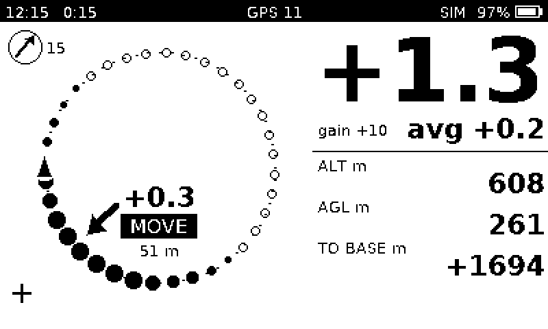 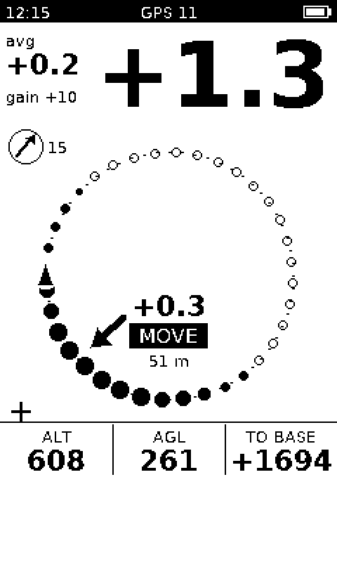

- **The circle:** heading up. Black dots for lift around the circle, open
  dots for sink, you on the side of your turn. The fitted core is a cross,
  with its size dotted when it fits. Other pilots show with their climb.
- **In the circle:** the thermal's average climb. Under it, the advice word
  (MOVE / STRAIGHTEN n s / TIGHTEN / WIDEN / CENTRED).
- **Around it:** the vario, the 20 s average and gain, altitude, height above
  ground, and height to cloud base ("~" until confirmed in a thermal). Wind,
  relative to your heading, sits at the top left.

### Glide (FLIGHT page, otherwise)

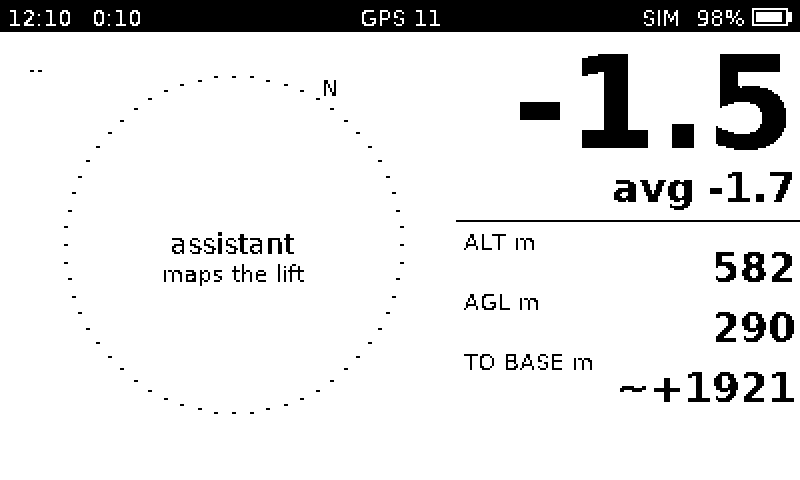 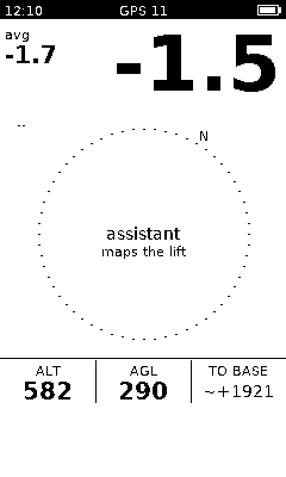

- **Target line:** what it is (TP / START - exit / PILOT / THERMAL / SUN /
  HOME), the distance, and the arrival height in this wind.
- **Compass:** the course arrow. On a task, a thin arrow also points to the
  thermal on the way.
- **BAR:** the step to use, with the effective MC. L/D over the last 30 s.
  "NEED +x m" when you can't reach the target yet, "FINAL MC x" on final
  glide.
- **Side view strip** along the bottom (see below).

### Side view (SIDE page)

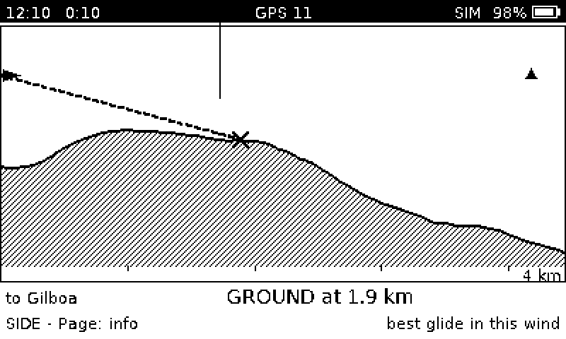 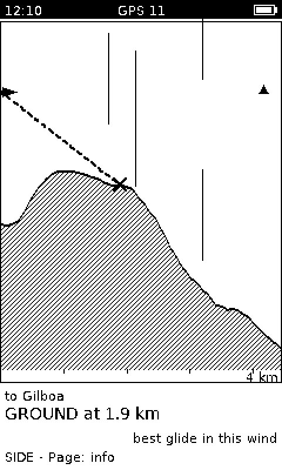

Along your course: to the next turnpoint, else the glide target, else home,
else straight ahead.

- **Terrain:** the ground profile from the terrain grid.
- **Your glide:** your best-glide line in this wind (dashed). An **X** marks
  where it would meet the ground, and it stops there.
- **Cloud base:** "base" when measured, "top" when it's the best top reached
  so far.
- **Thermals:** the target's thermal column (bold, leaning with the layer
  winds, a ring at your height), today's other sun triggers near the line
  (dotted), and other pilots.
- **Below the view:** where you'll hit the ground, or by how much you clear
  it.

### Info and Profile

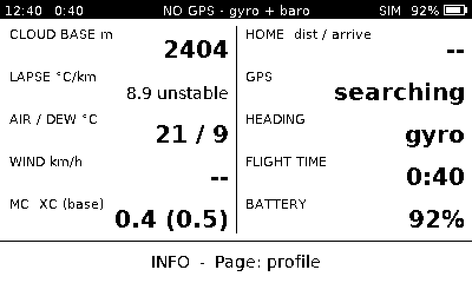 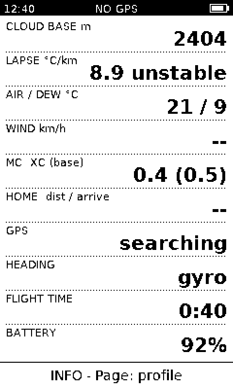

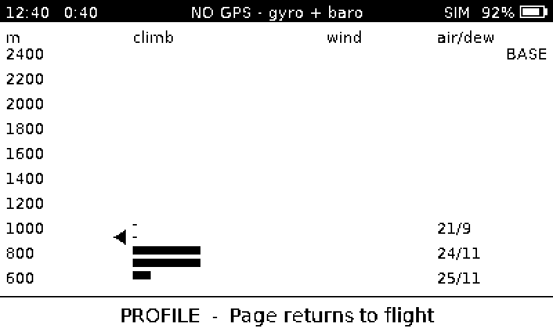 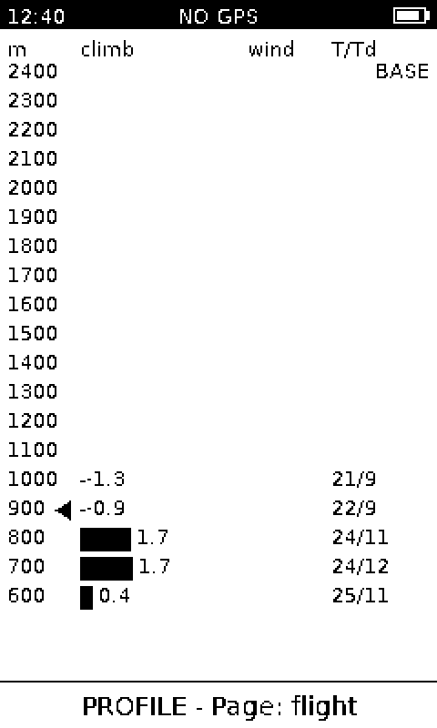

- **Info:** cloud base, stability, air/dew ("out" when it's from the remote's
  sensor), wind, effective and base MC, home, GPS state and why, heading
  source, flight time, battery.
- **Profile:** for each height band you've flown through, the climb, the
  wind, and the temperature and dew point. A marker shows your height.

### GPS trouble

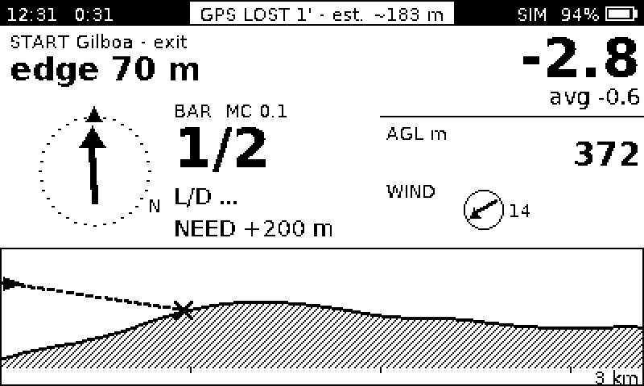 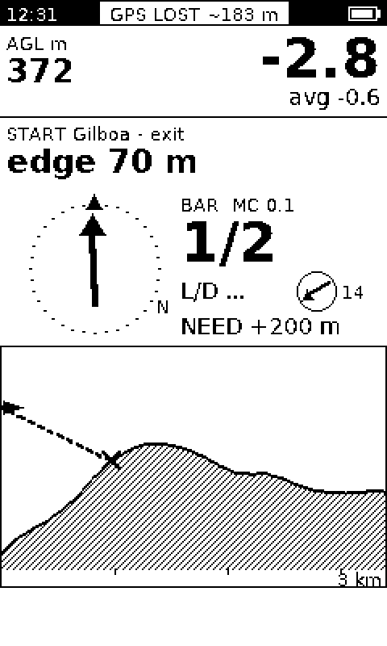

The status bar turns into an inverted label with the state and the estimated
position error. Everything that doesn't need GPS carries on.

## Which page, when

- **FLIGHT** picks itself: the thermal page while circling, the glide page
  otherwise. It **keeps the thermal page** while you straighten to MOVE and
  for 10 s after rolling out, unless the advice was GLIDE.
- **Page** (the remote's button) cycles FLIGHT → SIDE → INFO → PROFILE.
- A manual page **returns to FLIGHT after 20 s**, or at once on STAY, GLIDE,
  MOVE, TIGHTEN, WIDEN, FINAL GLIDE, a turnpoint or GPS LOST.
- Cues show in a banner at the bottom for 10–15 s.

## Settings (planned)

- **On the ground:** a page on your phone over the instrument's own Wi-Fi.
  It covers the polar and trim speed, orientation, units, sound levels, and
  uploading the task, thermal pack and terrain.
- **In the air:** the remote only (MC, volume, page, at base, messages).

[fb-live]: https://flybubble.com/flymaster-live-sd
[fb-rev]: https://flybubble.com/blogs/blog/flymaster-live-sd-review-and-tips
[v12-nav]: https://v12outdoor.com/products/nav-sd
[fm-man]: https://manualshive.com/en/manual/flymaster/nav/2311677?page=10
[xc-hyper]: https://xcmag.com/paraglider-reviews/naviter-hyper-review
[fb-oudie]: https://flybubble.com/blog/naviter-oudie-3-review-skywings
[navigator]: https://apps.apple.com/us/app/seeyou-navigator/id1485383554
[naviter-group]: https://groups.google.com/g/naviter-gliding-discussion-group/c/H3ncaf9TzuY
[lxnav]: https://www.manualslib.com/manual/1255645/Lxnav-Lx80xx.html?page=154
